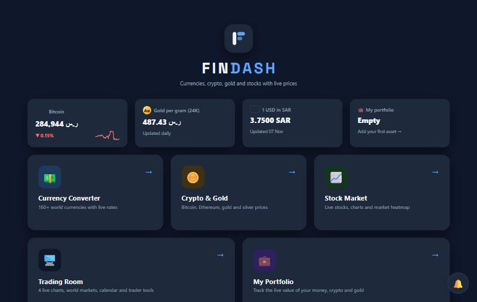

# FinDash

Currencies, crypto, gold and stocks with live prices, all in one website.

**🌐 Open it here: https://fahadazizdev.github.io/FinDash/**

## What's inside

- 💱 **Currency Converter**: 160+ world currencies with flags, search and live rates
- 🪙 **Crypto & Gold**: Bitcoin, Ethereum and more, plus gold and silver by gram, ounce or karat
- 📈 **Stock Market**: live charts, a watchlist, company details, news, top movers and a market heatmap
- 🖥️ **Trading Room**:
  - 1, 2, 4 or 6 live charts, with saved setups
  - a 24-hour market hours timeline and a market mood board
  - a Buy/Sell signal, top movers, news and an economic calendar
  - position-size and profit/loss calculators and trading notes
- 💼 **My Portfolio**: the live value of your money, crypto and gold in your main currency
- 🔔 **Price alerts**: get a notification when a price crosses your target

Works on phones and computers, in light and dark mode.

## Built with

- HTML, CSS and JavaScript only. No frameworks, nothing to install.
- Data from [ExchangeRate-API](https://www.exchangerate-api.com), [CoinGecko](https://www.coingecko.com), [Currency-API](https://github.com/fawazahmed0/exchange-api) and [TradingView](https://www.tradingview.com) widgets.

## Run it on your computer

Download the files and open `index.html` in your browser.

> Your watchlist, portfolio, alerts and notes are saved in your own browser only.
> Prices are for information only. This is not financial advice.

Made by Fahad Abdulaziz.

---

## بالعربي

موقع واحد يعرض لك العملات والكريبتو والذهب والأسهم بأسعار مباشرة.

🌐 **الرابط:** https://fahadazizdev.github.io/FinDash/

**المميزات:**

- 💱 **محوّل العملات:** أكثر من 160 عملة مع الأعلام والبحث وأسعار محدّثة.
- 🪙 **الكريبتو والذهب:** بيتكوين وإيثيريوم وغيرها، وسعر الذهب والفضة بالغرام أو الأونصة أو حسب العيار.
- 📈 **سوق الأسهم:** شارتات مباشرة وقائمة متابعة وأخبار وأكثر الأسهم حركة وخريطة السوق.
- 🖥️ **غرفة التداول:** من شارت واحد إلى 6 شارتات مباشرة، وأوقات فتح الأسواق العالمية ومؤشرات مزاج السوق، وإشارة شراء أو بيع، والتقويم الاقتصادي، وحاسبة حجم الصفقة والربح والخسارة.
- 💼 **محفظتي:** القيمة المباشرة لأموالك وعملاتك الرقمية وذهبك بعملتك.
- 🔔 **تنبيهات الأسعار:** يصلك إشعار لما يوصل السعر للهدف اللي حددته.

يعمل على الجوال والكمبيوتر، بالوضع الفاتح والداكن.

> بياناتك محفوظة في متصفحك فقط. الأسعار للمعلومة وليست نصيحة مالية.

صُنع بواسطة فهد عبدالعزيز.

